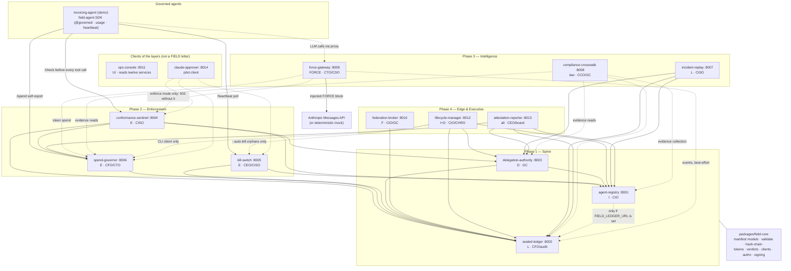
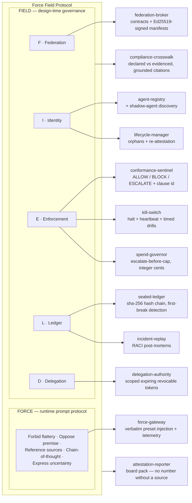
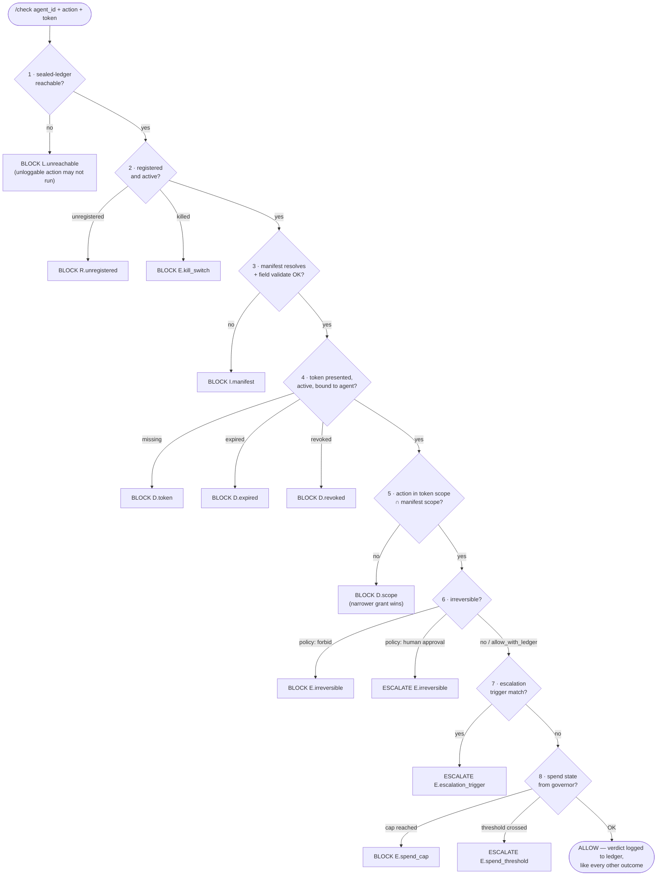
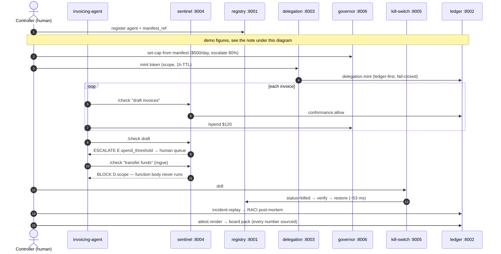

# FIELD Platform — Architecture

Reference implementation of the **Force Field Protocol**: FORCE (runtime
prompt protocol) + FIELD (design-time governance — Federation · Identity ·
Enforcement · Ledger · Delegation). The code is `field-core` (the
schema source of truth), the `field-agent` client SDK (`packages/`), and
fourteen services (`services/`), each owned by a named executive function. Two of the fourteen
are clients of the others rather than a layer of their own: `ops-console` and
`claude-approver` (below the diagram).

## 1. System architecture (layers, ports, dependencies)

Solid arrows = required runtime dependency. Dotted = optional/best-effort.
The dotted arrows added for the services that were missing from this diagram
are each marked from the code: registry to ledger exists only when
`FIELD_LEDGER_URL` is set (`services/agent-registry/src/agent_registry/api.py:187`);
gateway to sentinel is used only under `FORCE_GATEWAY_ENFORCE`, where an
unreachable or non-200 sentinel answers 503 and makes no upstream call
(`services/force-gateway/src/force_gateway/api.py:36-37`), and gateway events
are best-effort (`api.py:38-39`); lifecycle-manager to governor is the CLI's
estate client (`services/lifecycle-manager/src/lifecycle_manager/cli.py:187`,
`:211`), not the served API; crosswalk to delegation and governor are the
evidence reads (`services/compliance-crosswalk/src/compliance_crosswalk/api.py:224-232`,
a failed read yields none); claude-approver calls governor, kill-switch and
sentinel (`FIELD_GOVERNOR_URL`, `FIELD_KILLSWITCH_URL`, `FIELD_SENTINEL_URL` in
`services/claude-approver/src/claude_approver/`). I did not judge whether the
claude-approver arrows are required. `ops-console` is a UI: it reads
attestation, crosswalk, delegation, federation, gateway, governor, kill-switch,
ledger, lifecycle, registry, replay and sentinel by their `FIELD_*_URL`
variables (twelve of the other thirteen) and forwards a human's operator
credentials only on guarded writes; it keeps no store of its own, and the only
ledger records it writes are `operator.refused` for a refused human action
(`services/ops-console/src/ops_console/api.py:377-398`).
Every service imports `field-core`; no service redefines schema. Agents
integrate through `packages/field-agent` (the client SDK: sentinel-checked
actions, strict usage metering, fail-closed heartbeat — a client, not an
authority; see `docs/INTEGRATION.md`).

## 2. Logical diagram — the Force Field Protocol mapped to systems

**The honesty line, structurally:** a manifest *declares* governance
(field-core validates it); the spine *records* it; the enforcement layer
*makes it real*; the intelligence layer *proves it after the fact*; the
executive layer *reports it with sources*.

## 3. The enforcement decision (sentinel `/check`, first failing clause wins)

## 4. Capstone scenario (sequence)

The amounts and timings in this sequence are demo figures, not measurements of
an estate. The $500/day cap, the $120 spend and the 96% meter appear in
`docs/capstone-evidence/field-agent.md:14-18`; the 1 h token lifetime I did not
find in an artifact; the drill figure here (~53 ms) differs from the one run
recorded in `docs/capstone-evidence/field-agent-run.log:33` (kill confirmed
43.6 ms, total 56.3 ms), and I do not know where ~53 ms comes from.

## 5. Trust model & deliberate asymmetries

| Property | Posture |
|---|---|
| Authority **creation** (mint) | Ledger-first, **fail-closed** — unauditable authority must not exist |
| Authority **destruction** (kill) | **Act-first**, best-effort logging — a halt never waits on the audit trail |
| Dependency outages at the sentinel | Every one maps to a BLOCK clause (fail-closed) |
| Inter-service authn | `FIELD_SHARED_SECRET` → `x-field-auth` middleware on all APIs when set; `/health` open; TLS = fronting proxy |
| Federation authenticity | Ed25519 manifest signatures: an inbound crossing needs a contract key and a valid signature (Don D-19, C-175); a keyless contract is valid outbound only |
| Perimeter | Cooperative in the default posture: `@governed` + gateway route through checks; a process that never asks is contained by revocation + kill + discovery, not interception. With `FORCE_GATEWAY_ENFORCE` on, the gateway is also an enforcement point at the LLM egress: it refuses with 401, 403 or 503 and makes no upstream call when identity, authority or the sentinel is missing (`services/force-gateway/src/force_gateway/api.py:25-37`) |

## 6. Storage & event taxonomy

| Service | Store | Key ledger events |
|---|---|---|
| sealed-ledger | hash-chained JSONL segments: `ledger/events.jsonl` (open) + `events-<n>.jsonl` (closed) + `events.segments.journal`, `legal_hold.json`; archived segments with `<file>.segment.json` sidecars under `ledger-archive/` (C2) | it *is* the ledger; its own records are `ledger.segment.rotated`, `ledger.retention.applied`, `ledger.legal_hold.placed\|released` |
| agent-registry | SQLite `agents.sqlite3` | `registry.registered`, `registry.status_changed`, `registry.updated`, `registry.attested` — emitted when a ledger is wired (injected, or `FIELD_LEDGER_URL` set); silent otherwise, and the gap is then visible as missing `registry.*` events |
| delegation-authority | SQLite `tokens.sqlite3` (`tokens`, plus the v1.2 D1e side table `token_spend_ceilings`: a roster row's `max_spend_usd` stamped at mint) | `delegation.mint`, `delegation.revoke` |
| conformance-sentinel | stateless (mtime manifest cache) | `conformance.allow\|block\|escalate`, `conformance.shadow_*` (log-only), `sentinel.metering_gap` (a metering post on an ALLOW got no 201; D1), `sentinel.judge` |
| kill-switch | SQLite `killswitch/heartbeats.sqlite3` (check-ins only — the registry is still the authority on status) | `kill.agent`, `kill.domain`, `kill.revive`, `kill.drill.start|complete|restore_failed`, `kill.endpoint_called|failed|skipped` |
| spend-governor | SQLite `spend.sqlite3` (`spend` gains `action`/`source` at open in D1; `rate_limits` table) | `spend.recorded`, `spend.escalate`, `spend.cap_reached`, `spend.escalation_resolved`, `usage.recorded`, `spend.rate_limit_declared_unenforced` |
| federation-broker | SQLite `contracts.sqlite3` | `federation.allow\|block` |
| lifecycle-manager | last sweep + last tick under `lifecycle/` (the served API; the CLI job itself is stateless) | `lifecycle.expiring_authority`, `lifecycle.reattestation_due`, `lifecycle.orphan`, `lifecycle.decommissioned`, `lifecycle.tick_skipped` |
| incident-replay / attestation | stateless query engines | (readers, not writers) |
| ops-console | none (a UI; no SQLite in its source) | `operator.refused` (`services/ops-console/src/ops_console/api.py:377-398`); the writes it forwards are ledgered by the services that receive them |
| claude-approver | `$FIELD_DATA_DIR/claude-approver/usage-cursor.json` (`services/claude-approver/src/claude_approver/core.py:20-22`) | (none of its own: it calls governor, kill-switch and sentinel) |
| compliance-crosswalk | `crosswalk_stale_flags.json` (flags, history, regwatch `sources`, `last_check`) + its zero-byte `.lock` sidecar (D4) | (none: flags are set by regwatch or `set-stale`, cleared by name on the CLI) |
| force-gateway | SQLite `gateway/telemetry.sqlite3` (D2) | `gateway.bypass` (`api.py:651`), `gateway.drift_alert` (`api.py:711`), `gateway.refused` (`api.py:545`), `gateway.shadowed` (`api.py:572`), `gateway.tool_refused` (`api.py:633`), `gateway.passthrough` `{client_host, agent_id}` (secretless estates only; `agent_id` is the caller's `x-field-agent-id`, null for the platform judges); token spend forwarded to the governor, a passthrough naming an agent included |

All service data lives under `FIELD_DATA_DIR` (default `./var`, one shared
volume in compose).
